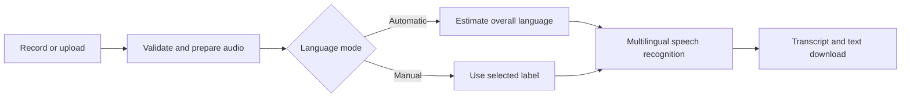

<p align="center">
  
</p>

<h1 align="center">NaijaSpeech</h1>
<p align="center"><strong>Yoruba, Hausa, and Igbo speech—in their own words.</strong></p>
<p align="center">
  <a href="https://huggingface.co/spaces/Harbidel/NaijaSpeech">Live demo</a> ·
  <a href="#quick-start">Run locally</a> ·
  <a href="#deployment">Deploy on Spaces</a>
</p>

NaijaSpeech is a multilingual automatic speech recognition (ASR) application for **Yoruba, Hausa, and Igbo**. It converts microphone recordings and uploaded audio into text through a Gradio interface, combining a fine-tuned XLS-R speech model with optional automatic language identification.

The app supports recordings up to **10 minutes** by default, Unicode transcript downloads, and Hugging Face ZeroGPU deployment. It is designed for hands-on testing and research demonstrations. Transcription quality should be evaluated on the speech and recording conditions relevant to your use case.

## Features

| Capability | Description |
| --- | --- |
| Record or upload | Separate microphone and file-upload tabs with waveform playback. |
| Multilingual transcription | Yoruba, Hausa, and Igbo recognition using one trained ASR checkpoint. |
| Automatic language identification | Estimates the overall language, with uncertain and unsupported-language results. |
| Manual language selection | Labels the recording and skips automatic identification. |
| Longer recordings | Processes overlapping audio sections instead of a single large inference window. |
| Transcript export | Copy text or download a UTF-8 file preserving Unicode characters and diacritics. |
| Processing feedback | One status/progress area, audio duration, ASR inference time, and word count. |
| Flexible hosting | Supports CPU, a dedicated CUDA GPU, and Hugging Face ZeroGPU. |

**Scope:** NaijaSpeech transcribes speech; it does not translate or separate speakers. Manual language selection does **not** force the shared ASR decoder to a particular language.

## Using the demo

1. Open [NaijaSpeech on Hugging Face Spaces](https://huggingface.co/spaces/Harbidel/NaijaSpeech).
2. Choose **Record** to use your microphone or **Upload recording** to select an audio file.
3. Choose **Auto-detect**, **Yoruba**, **Hausa**, or **Igbo** under **Recording language**.
4. Select **Transcribe audio** and follow progress in the **Status** area.
5. Review the result, then copy it or select **Download transcript**.

The active tab determines which recording is processed. Uploading a file does not start transcription automatically. First use may take longer while models are downloaded or initialized.

## Quick start

### Prerequisites

- **Python 3.12** and Git.
- **FFmpeg** installed and available on `PATH` for compressed audio and browser recording conversion.
- Access to a compatible trained ASR checkpoint. The default repository is private; cloning this application does not grant access to its weights.
- Sufficient RAM for the ASR model and optional detector. The detector has about 1 billion parameters; float32 weights alone require roughly 4 GB, before runtime overhead.

### Windows PowerShell

```powershell
git clone https://github.com/harbidel/NaijaSpeech.git
cd NaijaSpeech
py -3.12 -m venv .venv
.\.venv\Scripts\python -m pip install -r requirements.txt

# Authenticate if your chosen checkpoint is private.
.\.venv\Scripts\hf.exe auth login

.\.venv\Scripts\python app.py
```

### Linux / macOS

```bash
git clone https://github.com/harbidel/NaijaSpeech.git
cd NaijaSpeech
python3.12 -m venv .venv
source .venv/bin/activate
python -m pip install -r requirements.txt

# Authenticate if your chosen checkpoint is private.
hf auth login

python app.py
```

Open the address printed by Gradio, normally `http://127.0.0.1:7860`. Browser microphone recording requires permission and a secure context such as localhost or HTTPS.

Use a Hugging Face token with read access to the selected checkpoint. Browser login does not authenticate the Python application. Enter credentials through the CLI or environment; never commit tokens to source control.

## Model configuration

The ASR checkpoint is resolved in this order:

1. `MODEL_ID`, when explicitly configured.
2. A `final_model/` directory beside `app.py`, containing `config.json`.
3. A `model/` directory beside `app.py`, containing `config.json`.
4. `Harbidel/yoruba-hausa-igbo-xls-r-300m-ctc`.

A local export must include trained weights and the matching processor/tokenizer files:

```text
final_model/
├── config.json
├── model.safetensors
├── preprocessor_config.json
├── vocab.json
├── tokenizer_config.json
└── special_tokens_map.json
```

Include any additional tokenizer files or weight shards produced by `save_pretrained()`. A notebook alone is not a checkpoint. The app expects a compatible **Wav2Vec2 CTC** export; `MODEL_ID` is not a general-purpose switch to arbitrary ASR architectures.

| Variable | Default | Purpose |
| --- | --- | --- |
| `MODEL_ID` | Local-directory discovery, then the repository above | Compatible repository ID or local checkpoint path. |
| `HF_TOKEN` | Saved Hugging Face credentials, if available | Authentication for private repositories; use a Space secret when hosted. |
| `MAX_AUDIO_SECONDS` | `600` | Maximum duration in seconds; use a positive integer. |
| `LID_MODEL_ID` | `facebook/mms-lid-126` | Compatible Wav2Vec2 language classifier with ISO 639-3 labels. |

Restart after changing configuration. Increasing the duration limit increases processing time and queue occupancy. The separate **100 MB** upload cap is configured in `app.py`.

## How it works



Audio is validated, downmixed to mono, and resampled to **16 kHz**. The saved processor handles normalization. ASR runs in **20-second windows** with **3 seconds of context on each side**, using batch size 1. Overlap is removed in token space before decoding the joined sequence, avoiding naive concatenation of duplicated boundary words.

The 20-second window is not the recording limit. The app accepts **0.25–600 seconds** by default and rejects silent, unreadable, invalid, oversized, or unsupported multichannel inputs. One inference request runs at a time, with a queue limit of 12.

Models are cached after loading. On ZeroGPU, ASR is initialized on CUDA at startup and inference uses a `spaces.GPU` allocation of up to 120 seconds. Other environments use an available CUDA GPU or fall back to CPU. The reported inference time excludes audio preparation, model loading, and language identification.

### Language identification

Automatic mode uses [Meta MMS LID](https://huggingface.co/facebook/mms-lid-126) separately from ASR. It samples up to three 10-second windows across the recording and averages the classifier outputs. It considers all the detector's supported languages rather than forcing unrelated speech into Yoruba, Hausa, or Igbo.

A winning score below 0.5 is shown as uncertain. This is a heuristic, not calibrated confidence or transcription accuracy. Detection estimates an overall language; it does not label individual speakers or every language switch. It runs on CPU. If it fails, ASR can still proceed. Manual selection skips detection while retaining the same multilingual decoder.

## Deployment

1. Create a **Gradio Space** on Hugging Face.
2. Upload `app.py`, `asr.py`, `style.css`, `requirements.txt`, `packages.txt`, `README.md`, and `assets/logo.svg`, preserving the folder structure.
3. Under **Settings → Variables and secrets**, add `HF_TOKEN` as a **secret** with read access to the private model. Set `MODEL_ID` if needed.
4. Select suitable hardware. ZeroGPU is supported; availability and per-user quotas may affect requests.
5. Wait for the build and initialization, then test a short recording before a longer one.

Keep the YAML metadata at the top of this README intact, including `sdk: gradio`, `sdk_version`, `python_version`, and `app_file: app.py`. Spaces uses it to start the application. `packages.txt` installs FFmpeg. The notebook, local virtual environment, and deployment ZIP are not needed at runtime.

## Repository structure

```text
NaijaSpeech/
├── app.py                 # Interface, callbacks, progress and transcript export
├── asr.py                 # Audio preparation, loading, ASR and language ID
├── style.css              # Responsive interface styling
├── assets/
│   └── logo.svg           # Application logo
├── tests/
│   └── test_app.py        # Validation, routing and inference checks
├── requirements.txt       # Python dependencies
├── packages.txt           # System packages for Spaces
├── README.md
└── Multilingual_Yoruba_Hausa_Igbo_XLSR_CTC.ipynb
                           # Training workflow reference
```

## Testing

Run inside the configured Python environment:

```bash
python -m unittest discover -s tests -v
```

Tests cover audio validation, stereo conversion, resampling, recordings beyond 20 seconds, Unicode downloads, authentication errors, language decisions, manual mode, detector failures, and upload routing. A small locally initialized CTC model also exercises chunked inference without downloading the private checkpoint.

These checks verify application behavior, **not recognition accuracy**. Hosted smoke tests have exercised ASR and language identification using synthetic audio. Representative recordings and reference transcripts are needed to measure word error rate (WER), character error rate (CER), and language-identification quality. No benchmark scores are claimed here.

## Limitations

- Noise, microphone quality, accents, speaking style, and unfamiliar domains can affect results.
- Code-switching may produce incomplete or inaccurate language labels and transcripts.
- Output generally reflects training text: lowercase, limited punctuation, and learned diacritics.
- Long recordings can take several minutes, especially on CPU. An accepted duration does not guarantee completion within a ZeroGPU allocation or quota.
- Review transcripts before publication or consequential use.

## Privacy and data handling

Audio is sent to the host running the app. The application does not add uploads to a training dataset or intentionally log transcript content. Audio handling and transcript downloads use temporary files.

Gradio is configured to clean cached files hourly when they are older than one hour, while the app is running. **Reset clears the interface; it does not guarantee immediate deletion of cached files.** Hosting-provider logging, access controls, and retention policies are separate. Only upload recordings you have permission to process.

## Troubleshooting

| Symptom | Recommended action |
| --- | --- |
| Model access denied / 401 or 403 | Run `hf auth login` locally, or add `HF_TOKEN` as a Space secret. Confirm access to the private repository. |
| Missing SDK in configuration | Restore the required YAML metadata at the top of this README. |
| Slow first request | Allow time for downloads and initialization. Manual selection avoids loading the detector. |
| Language detection unavailable | Check memory, connectivity, and detector settings. Manual selection still permits transcription. |
| Audio cannot be read | Check FFmpeg installation or export mono/stereo WAV at 16 kHz. |
| Microphone unavailable | Check browser permissions and device selection, or use file upload. |
| GPU allocation failure or timeout | Check ZeroGPU quota and availability; try a shorter recording. |
| Old interface styling | Hard-refresh after deployment and confirm the Space has restarted. |

## Licensing and acknowledgements

Built with [Gradio](https://www.gradio.app/), [Transformers](https://github.com/huggingface/transformers), [PyTorch](https://pytorch.org/), and the [XLS-R](https://huggingface.co/facebook/wav2vec2-xls-r-300m) model family.

The default language detector, [`facebook/mms-lid-126`](https://huggingface.co/facebook/mms-lid-126), is licensed **CC-BY-NC-4.0**, which restricts commercial use. Review its model card and license before reuse. The fine-tuned ASR checkpoint and training data have their own terms and must be checked independently.

This repository currently has no standalone `LICENSE` file. Do not assume that dependency or model licenses grant a license to the application code; contact the maintainer about reuse.

Maintained by [Afolabi Abeeb Adebayo (Harbidel)](https://huggingface.co/Harbidel). Report reproducible problems through [GitHub Issues](https://github.com/harbidel/NaijaSpeech/issues), including the runtime environment, error, and non-sensitive reproduction steps. Do not include access tokens or private recordings.
